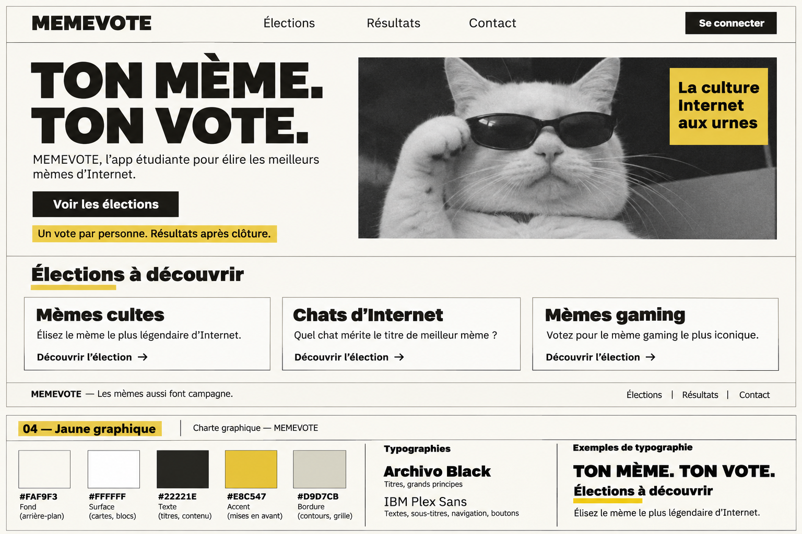

## MVP1 : 
- Réalisation de la carte graphique -> Cristina
- Page d'accueil / index.php        -> Raphaël
- Page de contact / contact.php     -> Cristina
- Mise en page / style.css          -> Raphaël

## Utilisation de l'IA : 

#### Charte graphique : 
> propose moi 5 maquettes de page d'accueil pour ma saé sur le thème des memes
garde un thème clair, ne fait aucun bord arrondi, évite les couleurs bleutées et évite de mettre trop de détails, garde un style plutôt sobre mais moderne (le public cible concerne principalement des jeunes)
> je veux que pour chaque maquettes tu génères la charte graphique associée avec les teintes et polices utilisées

**Inspiration retenue :**
            

